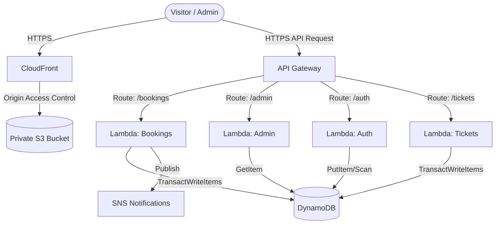

# Architecture Deep Dive

## High-Level AWS Architecture



## DynamoDB Data Modeling

The system uses specific, isolated tables to enforce strict access control and optimize performance:

1.  **Museum_Users**: Handles Auth. Registration is hardcoded to `Visitor` to prevent privilege escalation.
2.  **Museum_Exhibitions**: Catalog of available events.
3.  **Museum_Schedules**: Contains `capacity` and `bookedCount`.
4.  **Museum_Bookings**: The authoritative source of truth for a visitor's ticket.
5.  **Museum_EntryRecords**: Append-only log for when a QR ticket is scanned at the door. Prevents ticket reuse.
6.  **Museum_Statistics**: A denormalized, read-optimized table used explicitly for the Admin Dashboard.

### Preventing Capacity Race Conditions (The Golden Path)
When a user books a ticket, the `Bookings` Lambda executes a **DynamoDB Transaction**:
```json
TransactItems: [
  {
    Update: {
      TableName: "Museum_Schedules",
      UpdateExpression: "SET bookedCount = bookedCount + :requested",
      ConditionExpression: "bookedCount + :requested <= capacity"
    }
  },
  {
    Put: { TableName: "Museum_Bookings" }
  },
  {
    Update: { TableName: "Museum_Statistics", Key: "GLOBAL_TOTALS" }
  }
]
```
If two users request the final slot concurrently, DynamoDB's ACID compliance guarantees one transaction will fail the `ConditionExpression`, aborting the entire block and protecting the statistics and bookings tables from diverging.

## Security & IAM Least Privilege
Using `serverless-iam-roles-per-function`, each Lambda has a unique AWS IAM Role.
*   The `Auth` function cannot read the `Bookings` table.
*   The `AdminDashboard` function can only `GetItem` from the `Museum_Statistics` table. It cannot `Scan` or modify user data.

## Frontend Security (OAC)
The React SPA is deployed to S3. To prevent unauthorized direct access, the S3 Bucket has `BlockPublicAccess` enabled. Traffic is securely routed through CloudFront via Origin Access Control (OAC), ensuring the website is only accessible via the CDN's HTTPS edge nodes.
